<p align="center">
  <a href="https://arxiv.org/abs/2603.00175">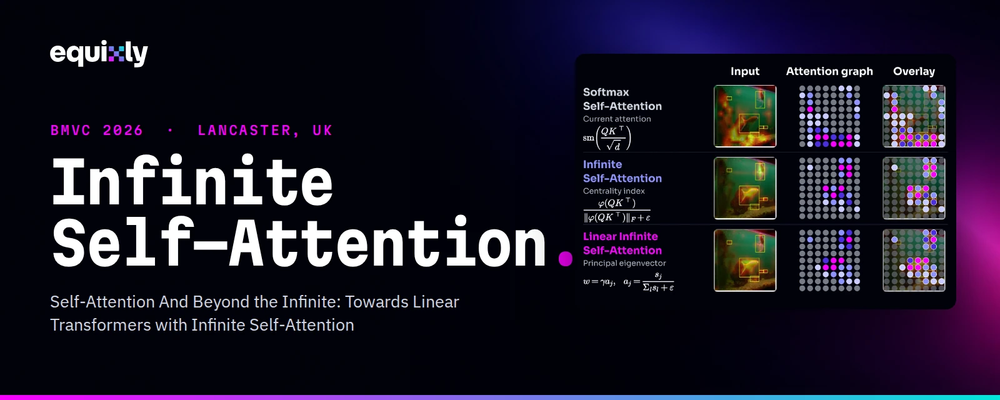</a>
</p>

<h1 align="center">Infinite Self-Attention (InfSA)</h1>

<p align="center">
  <b>Self-Attention And Beyond the Infinite: Towards Linear Transformers with Infinite Self-Attention</b><br>
  BMVC 2026 · Lancaster, UK · 23–26 November 2026 · Paper 46
</p>

<p align="center">
  Giorgio Roffo<sup>1,*</sup> &nbsp;·&nbsp; Hazem Abdelkawy<sup>2</sup> &nbsp;·&nbsp; Nilli Lavie<sup>3</sup> &nbsp;·&nbsp; Luke Palmer<sup>4,*</sup><br>
  <sup>1</sup><a href="https://equixly.com/">Equixly</a> &nbsp;
  <sup>2</sup><a href="https://www.toyota-europe.com/">Toyota Motor Europe</a> &nbsp;
  <sup>3</sup><a href="http://mindvisionlabs.com/">MindVisionLabs</a>, <a href="https://www.ucl.ac.uk/">University College London</a> &nbsp;
  <sup>4</sup><a href="https://glimpse.ml/">GlimpseML</a>
</p>

<p align="center">
  <a href="https://arxiv.org/abs/2603.00175"></a>
  <a href="https://youtu.be/c27p0Gj9iuo"></a>
  <a href="docs/static/pdf/InfSA_BMVC2026_poster.pdf"></a>
  
</p>

<p align="center">
  <a href="#abstract">Abstract</a> ·
  <a href="#key-idea">Key idea</a> ·
  <a href="#method">Method</a> ·
  <a href="#results">Results</a> ·
  <a href="#paper-presentation">Presentation</a> ·
  <a href="#poster">Poster</a> ·
  <a href="#equixly-at-bmvc-2026">At BMVC</a> ·
  <a href="#citation">Citation</a> ·
  <a href="#team">Team</a>
</p>

<p align="center">
  <a href="https://equixly.com/"></a>
  <a href="https://www.toyota-europe.com/"></a>
  <a href="http://mindvisionlabs.com/"></a>
  <a href="https://www.ucl.ac.uk/"></a>
  <a href="https://glimpse.ml/"></a>
  <a href="https://bmvc2026.bmva.org/"></a>
</p>

> *“One change to attention, Frobenius-normalised ReLU instead of softmax, turns each layer into a centrality computation: more accurate, interpretable, and in its linear form 13× cheaper at 1024².”*

| **84.7%** | **13×** | **9216²** | **76.0%** |
|:--|:--|:--|:--|
| top-1 on ImageNet-1K with a 4-layer ViT, +3.2 pp over the same model with softmax | throughput and energy at 1024², against a standard ViT of equal depth | inference, about 332k tokens: the only one of nine tested models to complete it | MoRF-AOC of the attention maps, against 42.6% for softmax ViT |

## Abstract

The quadratic cost of softmax attention limits Transformer scalability in high-resolution vision. We introduce *Infinite Self-Attention* (InfSA), a spectral reformulation that treats each attention layer as a diffusion step on a content-adaptive token graph, accumulating multi-hop interactions through a discounted Neumann series over attention matrices. This connects self-attention to classical graph centrality (Katz, PageRank, eigenvector centrality), yielding interpretable, structurally grounded token weighting. The same kernel is the fundamental matrix of an absorbing Markov chain, so a token’s centrality equals its expected random-walk visits before absorption. We then propose *Linear-InfSA*, an O(N) variant that approximates the principal eigenvector of the implicit attention operator without forming the N × N matrix. It maintains an auxiliary state of fixed size O(d), independent of the sequence length N, is drop-in compatible with standard Vision Transformers, and supports stable training at 4096² and inference at 9216² (∼332k tokens). Integrated into a 4-layer ViT with 53.5M parameters and 59 GFLOPs at 224², Linear-InfSA achieves 84.7% top-1 on ImageNet-1K, a +3.2 pp purely architectural gain over a standard 4-layer ViT baseline (81.5%) trained with an identical recipe. On ImageNet-V2, all InfViT variants surpass every compared baseline (up to 79.8% vs. 76.8% for the best prior method), indicating robust generalization. Attention maps are semantically grounded: MoRF-AOC reaches 76.0% and bounding-box PR-AUC 76.1%, versus 42.6% and 56.2% for softmax ViT. On an A100 40 GB GPU, Linear-InfViT sustains 1024² inference at 231 img/s and 0.87 J/img, a 13× improvement in throughput and energy over a standard ViT of equal depth, and is the only tested model to complete 9216² inference without running out of memory. The linear approximation recovers the dominant eigenvector of the full quadratic operator (cosine similarity 0.985).

## Key idea

**Attention as diffusion on a token graph.** Softmax attention costs O(N²), spreads over the background and has no model of multi-hop influence. InfSA treats each layer as one diffusion step and sums walks of all lengths, so tokens are ranked by centrality. Linear-InfSA gives the same ranking in O(N), with no N × N matrix.

<p align="center">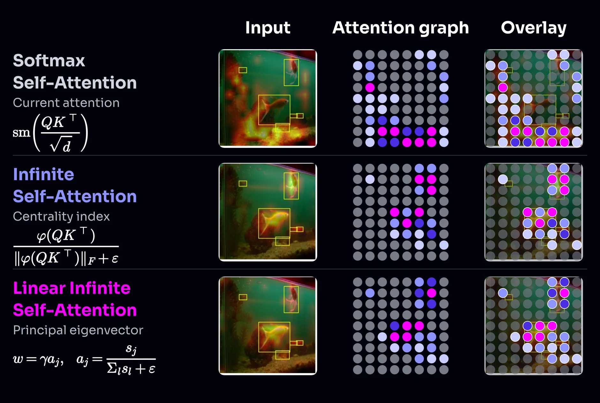</p>

## Method

| 1 · InfSA | 2 · Markov chain | 3 · Linear-InfSA |
|:--|:--|:--|
| **A discounted sum over all paths.** Aᵗ sums all walks of length t; γ discounts long paths. The closed form is the Katz kernel (up to the t = 0 term). ReLU and Frobenius normalisation give ρ(Â) ≤ 1, so the series converges for γ < 1. | **Centrality = expected visits of a random walk.** Rows sum below 1 (assumed; holds in trained models), so each step may be absorbed. The expected visits before absorption are the same kernel. | **Eigenvector centrality in O(N).** Tie Q = K, a soft central query, one positive-kernel step: about one power-method step (cosine 0.985, Spearman 0.937 with the Perron eigenvector). 64 heads restore expressivity. |

<p align="center">
  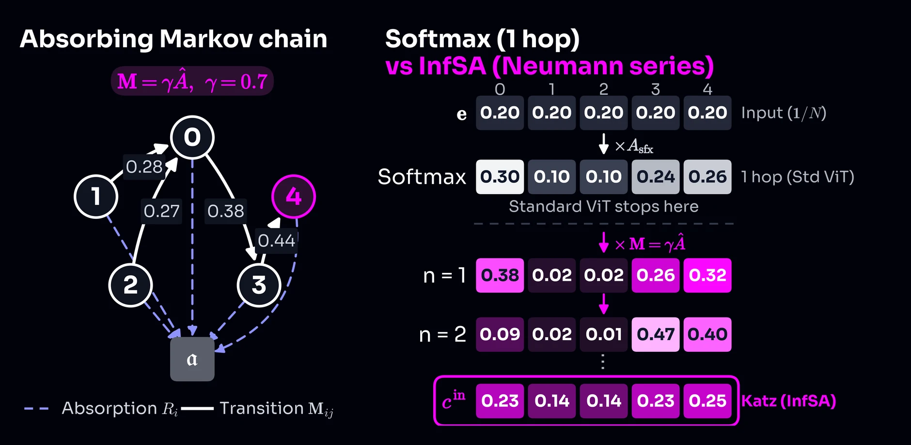
  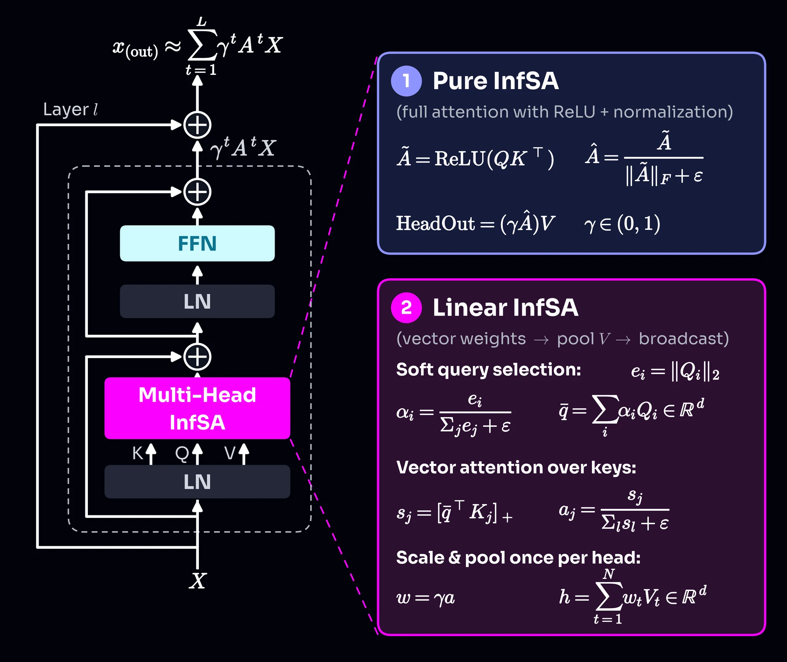
</p>

Toy graph, γ = 0.7: softmax (one hop) ranks token 0 first; the path 0→3→4 moves mass to token 4, which InfSA ranks first. The InfSA block is drop-in compatible with a standard Vision Transformer.

## Results

<p align="center">
  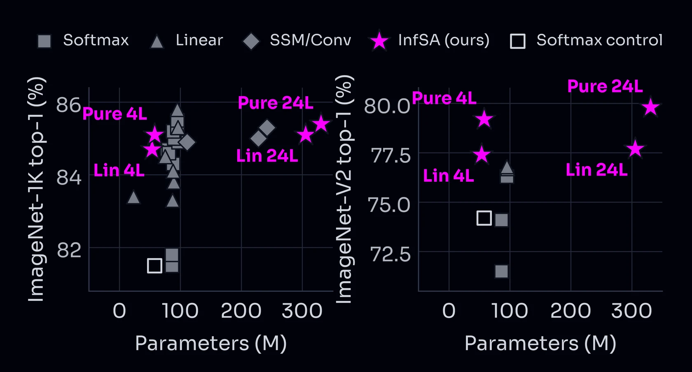
  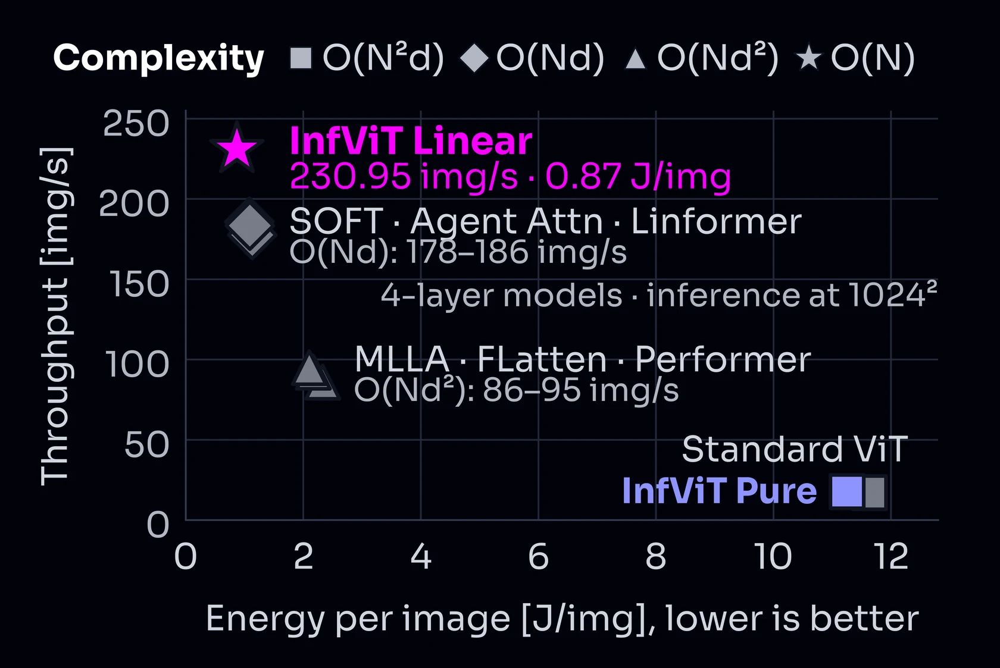
</p>

- **One recipe: +3.2 pp (Linear), +3.6 pp (Pure).** The 4-layer InfViT surpasses Agent Attn-B (84.1) and FLatten (≤ 84.5) at about 2/3 of the parameters. On ImageNet-V2 all four InfViT models are above every published backbone (79.8% vs 76.8%).
- **The only one of nine to reach 9216².** At 1024²: 231 img/s and 0.87 J/img, 13× a ViT of equal depth and 1.2–2.7× the other efficient models. 81× the tokens cost 74× the time; training is stable at 4096².
- **Attention lands on the objects.** 4-layer models: MoRF-AOC 76.0 vs 42.6; bounding-box PR-AUC 76.1 vs 56.2.

<p align="center">
  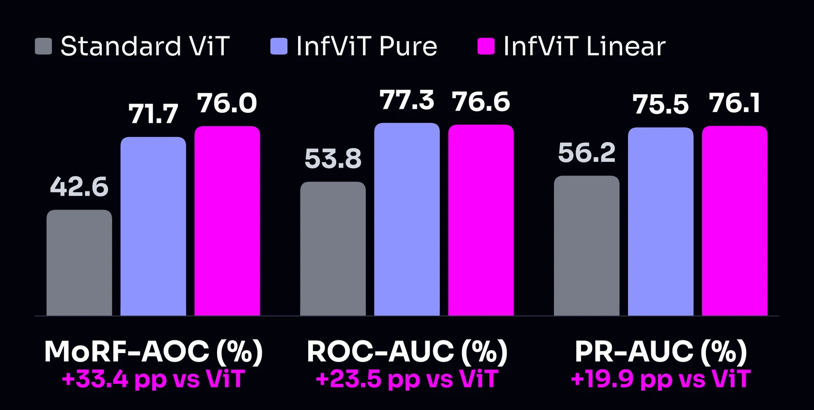
  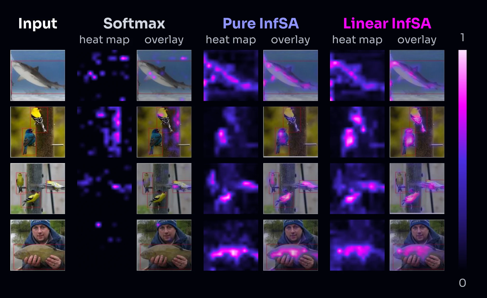
</p>

## Paper presentation

<p align="center">
  <a href="https://youtu.be/c27p0Gj9iuo">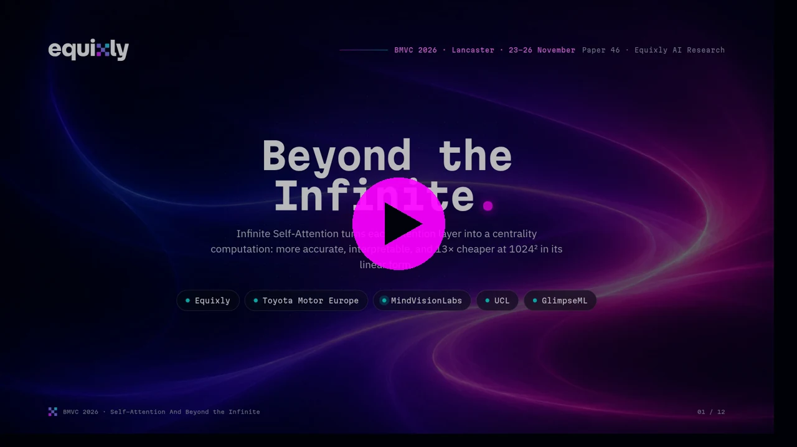</a>
</p>

## Poster

**Poster Session 6 · Wednesday 25 November 2026 · 13:30–15:15 · Lancaster Town Hall**

<p align="center">
  <a href="docs/static/pdf/InfSA_BMVC2026_poster.pdf">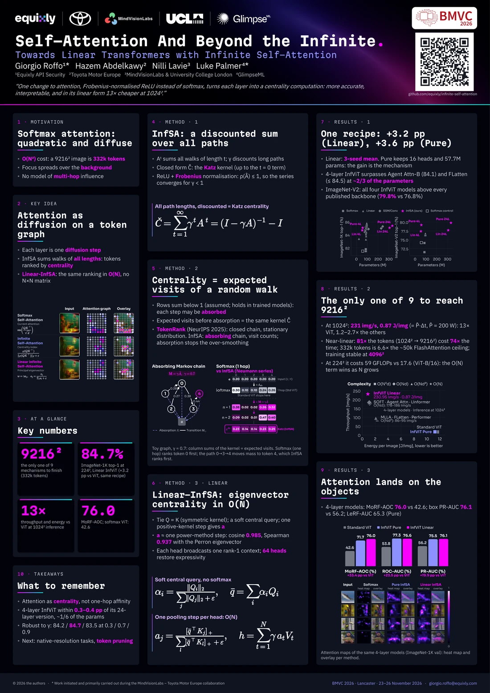</a><br>
  <a href="docs/static/pdf/InfSA_BMVC2026_poster.pdf">Download the poster (PDF)</a>
</p>

## Equixly at BMVC 2026

Equixly is a Silver Sponsor of BMVC 2026. Come and talk to us at Poster Session 6.

<p align="center">
  <a href="https://youtu.be/_K3CLIxezMs">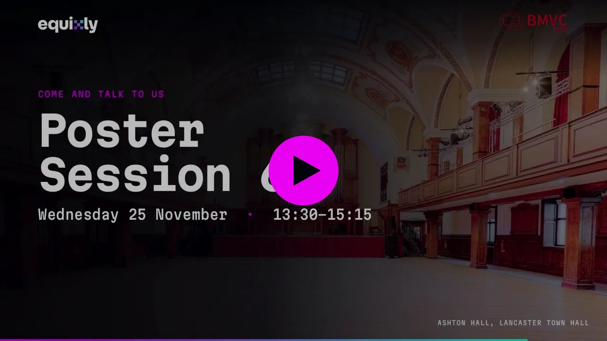</a>
</p>

## Code

Coming soon.

## Citation

```bibtex
@inproceedings{roffo2026infsa,
  title     = {Self-Attention And Beyond the Infinite: Towards Linear Transformers with Infinite Self-Attention},
  author    = {Roffo, Giorgio and Abdelkawy, Hazem and Lavie, Nilli and Palmer, Luke},
  booktitle = {37th British Machine Vision Conference 2026, {BMVC} 2026, Lancaster, UK, November 23-26, 2026},
  publisher = {BMVA},
  year      = {2026},
  eprint    = {2603.00175},
  archivePrefix = {arXiv}
}
```

## Team

| Organisation | Author |
|:--|:--|
| [Equixly](https://equixly.com/) | Giorgio Roffo |
| [Toyota Motor Europe](https://www.toyota-europe.com/) | Hazem Abdelkawy |
| [MindVisionLabs](http://mindvisionlabs.com/) · [University College London](https://www.ucl.ac.uk/) | Nilli Lavie |
| [GlimpseML](https://glimpse.ml/) | Luke Palmer |

<sup>*</sup> This work was initiated and primarily carried out during the collaboration between MindVisionLabs and Toyota Motor Europe.

## Licence

© 2026 the authors. Text, figures, poster and video are released under [CC BY-NC-ND 4.0](LICENSE) (non-commercial). Logos and names are trademarks of their owners.
